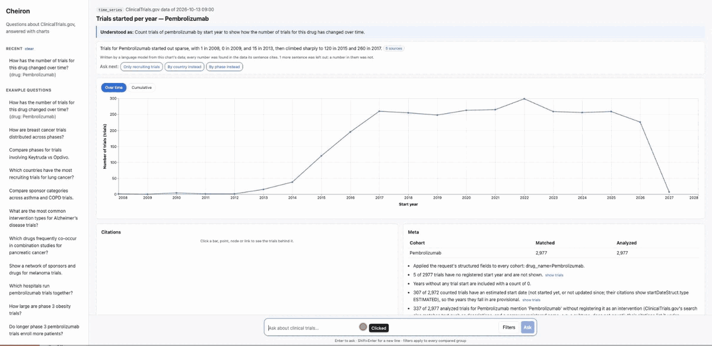

# Cheiron — ClinicalTrials.gov Query-to-Visualization Agent

English | [한국어](README.ko.md)

Ask a question about clinical trials in plain English and get back a chart specification any
frontend can render, computed from the live [ClinicalTrials.gov Data API](https://clinicaltrials.gov/data-api/api),
with every bar, point, node and link citing the trial records behind it.

- **One grammar, many charts.** An LLM turns the question into one of five analysis plans;
  deterministic code fetches the data and builds the chart: bar, grouped bar, time series,
  histogram, scatter, network graph or a single trial's posted results, each with alternative
  views (map, donut, heatmap, 100% stack, cumulative line, forest plot).
- **The LLM never writes a number.** It plans with enums and quotes the question for every
  filter; unquoted filters are corrected or dropped, and unanswerable questions are refused.
- **Deep citations.** Each datum lists its trials with the exact API field and value that put
  them there, plus the passage of the record naming the filtered drug or condition.
- **Exact counts beyond the sample.** Large cohorts are counted by the registry itself or tallied
  from all records (up to 25,000 trials), and each count links to the API request that reproduces it.
- **Networks with structure.** Clusters, anchors and association strength; drugs combined in one
  arm vs compared across arms; sponsors leading vs collaborating.
- **Conversation.** A short answer in words whose numbers are checked against the data,
  follow-ups that refine the previous plan, and next questions planned before they are offered.
- **Demo.** A React UI renders every chart type from the spec alone.

The reasoning and measurements behind each decision are in [docs/design.md](docs/design.md);
five example runs with their actual JSON are [below](#example-runs).

## One question, from the user's side



<sub>Recorded on the demo with the registry snapshot of 2026-10-13: a question, the written answer and
its sources, a bar's citations, the AI check on them, and a suggested follow-up.</sub>

The demo (<http://localhost:8080>) follows the way a researcher works with a question: ask,
read, check, refine. Each step was designed to give an answer the user can trust without
leaving the page.

1. **Ask in plain words.** "Compare phases for trials involving Keytruda vs Opdivo." The page
   shows how the question was understood ("Understood as …"), the chart, and tabs with other
   views of the same numbers (a 100% stack, a heatmap; a world map when the answer is countries).
2. **Read the answer, not only the chart.** A few sentences answer the question above the chart,
   e.g. that Phase 2 is the largest group for both drugs, with 1,777 Keytruda and 1,164 Opdivo
   trials. Every number was checked against the data, and each sentence's "sources" open the
   bars it comes from.
3. **Click any bar, point, node or link to see why.** The citation panel lists the trials behind
   it, each with the registered field and value that put it there and the sentence of the record
   that names the drug or condition, linked to ClinicalTrials.gov. "List the other trials" goes
   past the first five, 20 at a time.
4. **Let AI read the trials.** The registry's search also returns trials that only mention a
   drug. "Ask AI what Keytruda is to these trials" reads each record and says whether the drug is
   studied, given alongside, an eligibility condition or background, quoting the record; a quote
   not found in the record is not accepted.
5. **Keep going without retyping.** "Ask next" offers follow-ups that are already planned ("Only
   recruiting trials", "By country instead"), or the user types one ("only phase 3"); a chip over
   the question box shows that it refines the last answer, and filters kept from earlier
   questions are listed.
6. **Trust the numbers.** Counts beyond the 5,000-trial sample are exact, each bar linking to the
   API request that reproduces it; the data snapshot is shown, and Recent reopens earlier answers
   at once, asking again only when the registry has published new data.

The same flow works for trends, maps, networks (drugs combined or compared, sponsors leading or
collaborating) and a single trial's posted results with their confidence intervals. Behind every
step is one rule: the LLM interprets and writes, code computes and checks
([How it works](#how-it-works)).

## Quick start

```bash
cp .env.example .env          # set OPENAI_API_KEY
docker compose up --build     # UI http://localhost:8080 · API http://localhost:8080/api · docs /api/docs
```

| Variable | Default | Purpose |
|---|---|---|
| `OPENAI_API_KEY` | — | needed by `/api/visualize`, `/api/answers`, `/api/mentions`; `/api/plans` works without it |
| `OPENAI_MODEL` | `gpt-5.4-mini` | model for every LLM role |
| `OPENAI_REASONING_EFFORT` | `low` | planner and answer writer; empty for non-reasoning models |
| `OPENAI_MENTION_REASONING_EFFORT` | `high` | the mention judge |

Local development needs [uv](https://docs.astral.sh/uv/) (it installs Python 3.14) and Node 22:

```bash
cd backend && uv sync && uv run --env-file ../.env uvicorn cheiron.main:app --reload   # :8000
cd frontend && npm install && npm run dev                                           # :5173
cd backend && uv run pytest                                  # 324 offline tests
uv run pytest -m live                                        # contract checks on the live API
uv run --env-file ../.env pytest -m llm                      # LLM evaluations (real model)
cd ../frontend && npm run build && npm run lint              # type-check, build, lint
```

## API

| Endpoint | Purpose |
|---|---|
| `POST /api/visualize` | Question (+ optional filters, + `context` for a follow-up) → plan → visualization |
| `POST /api/answers` | The same request + the `plan` that answered it → a short answer in words and planned follow-ups |
| `POST /api/plans` | Run an analysis plan directly, without the LLM (`meta.plan` of any answer is a valid request) |
| `POST /api/mentions` | Why trials mention a term (studied, given alongside, eligibility, background), judged by the LLM with a verified quote |
| `GET /api/options` | Filter choices: registry countries with counts, common terms, phase and status codes |
| `GET /api/version` | The registry data snapshot being served |
| `GET /api/docs` | OpenAPI documentation generated from the schemas |

### Request: `POST /api/visualize`

```json
{ "query": "How has the number of trials for this drug changed over time?", "drug_name": "Pembrolizumab" }
```

| Field | Type | Rules |
|---|---|---|
| `query` | string, 1–1,000 chars | required |
| `drug_name`, `condition`, `sponsor` | string ≤ 200 | optional; applied to every cohort, override the planner |
| `country` | string ≤ 100 | optional; a trial with at least one site there |
| `phases`, `statuses` | list of registry codes (`PHASE3`, `RECRUITING`, …) | optional; any of |
| `start_year`, `end_year` | integer 1900–2100 | optional; start ≤ end |
| `nct_id` | `NCT` + 8 digits | optional; for a trial's results, use this trial |
| `context` | `{"questions": [...], "plan": {...}}` | optional; a follow-up's earlier questions (≤ 5) and the last answer's `meta.plan` |
| `max_trials_per_cohort` | integer 1–10,000 | default 5,000 |
| `all_citation_ids` | boolean | default `false`; list every contributing NCT ID per datum |

Unknown fields and invalid values are rejected with `422`. Errors: `422` with a `code` for
questions no analysis can answer (`unsupported_question` with a `reason`), unknown trials
(`trial_not_found`), trials without results (`no_posted_results`) and plans still invalid after
one correction round (`plan_rejected`); `502` when ClinicalTrials.gov fails; `503` without an
LLM key.

### Response

```jsonc
{
  "visualization": {
    "type": "grouped_bar_chart",
    "title": "Trials by phase — Keytruda vs Opdivo",
    "encoding": {
      "x": { "field": "phase", "type": "ordinal", "title": "Phase", "order": ["Early Phase 1", "..."] },
      "y": { "field": "trial_count", "type": "quantitative", "title": "Number of trials", "unit": "trials" },
      "series": { "field": "cohort", "type": "nominal", "title": "Cohort", "order": ["Keytruda", "Opdivo"] }
    },
    "data": [ { "phase": "Phase 3", "cohort": "Keytruda", "trial_count": 369, "citations": { ... } }, "..." ]
  },
  "alternatives": [ { "type": "stacked_bar_chart", "...": "...", "notes": [ "..." ] }, { "type": "heatmap", "...": "..." } ],
  "meta": {
    "source": "clinicaltrials.gov",
    "query": "Compare phases for trials involving Keytruda vs Opdivo.",
    "interpretation": "I will compare the phase distribution of trials involving Keytruda versus trials involving Opdivo.",
    "plan": { "kind": "count_by", "cohorts": [ "..." ], "dimension": "phase" },     // rerunnable as-is
    "cohorts": [ { "label": "Keytruda", "matched": 2974, "analyzed": 2974, "truncated": false,
                   "exact_counts": false, "names": ["Keytruda", "Pembrolizumab"] } ],
    "notes": [ "175 of 2974 trials in Keytruda have no registered phase and are not shown.", "..." ],
    "note_citations": [ { "note": "175 of 2974 trials ...", "citations": { ... } } ],
    "data_version": "2026-10-09T09:00:05"
  }
}
```

Every encoding channel is `{ field, type, title, order, unit, time_unit, scale }`, with `type` one
of Vega-Lite's `nominal`, `ordinal`, `quantitative`, `temporal`; `order` is the category order to
draw and `scale` is `null` or `"symlog"`.

| `type` | Channels | `data` |
|---|---|---|
| `bar_chart` | `x`, `y` | one row per category |
| `grouped_bar_chart` | `x`, `y`, `series` (+ `y_lower`, `y_upper` for a trial's results) | one row per category × series, zeros included |
| `time_series` | `x` (`time_unit: "year"`), `y`, optional `series` | one row per year, gaps filled with 0 |
| `histogram` | `x` (`bin_start`), `x2` (`bin_end`), `y` | one row per bin `[start, end)` |
| `scatter_plot` | `x`, `y`, `tooltip` | one row per trial |
| `network_graph` | `node_id`, `node_label`, `node_size`, `node_color` (cluster), `node_shape` (kind), `edge_source`, `edge_target`, `edge_weight` (shared trials), `edge_strength` (association), `edge_style` (combined / compared, lead / collaborator) | `{ "nodes": [...], "edges": [...] }` |
| alternatives | `stacked_bar_chart`, `heatmap`, `choropleth_map` (ISO 3166-1 numeric `region`), `donut_chart`, `line_chart`, `forest_plot` | derived from the primary's rows |

### Citations

Every row, node and edge carries `citations`:

```json
{ "total": 369,
  "items": [ { "nct_id": "NCT04003636",
               "title": "Pembrolizumab (MK-3475) Plus Gemcitabine/Cisplatin ... (KEYNOTE-966)",
               "url": "https://clinicaltrials.gov/study/NCT04003636",
               "evidence": [ { "field": "protocolSection.designModule.phases", "value": "PHASE3" },
                             { "field": "protocolSection.armsInterventionsModule.interventions.name", "value": "Pembrolizumab" } ],
               "excerpt": "phases: PHASE3; interventions.name: Pembrolizumab",
               "mentioned_only": [] } ],
  "nct_ids": null,
  "registry_query": null }
```

- `evidence` is the field path in the API's study JSON and the value as registered; `excerpt` is
  the same on one line, as in the assignment's example. Checked against the live records, all 433
  evidence entries of the example runs match: 341 equal the field's value, 92 are verbatim passages.
- `items` spells out the first five trials; `total` counts all of them; `nct_ids` lists every one
  with `all_citation_ids`; `registry_query` is the API request that reproduces a registry count.
- `mentioned_only` names filter terms the trial only mentions in its text without registering
  them (ClinicalTrials.gov's search matches both; `meta.notes` counts them).
- Alternative views refer to the primary's citations instead of repeating them:
  `{"$ref": "#/visualization/data/3/citations"}`.

## How it works

```
question (+ filters, + conversation)
  → Planner (LLM)     PlanDraft: an analysis plan in enums, with the question's words quoted per filter
  → Grounding         quotes checked against the question(s); filters applied; domain rules;
                      a rejected draft gets one correction round
  → Registry          ClinicalTrials.gov API: paged searches, per-category counts, tallies (cached per snapshot)
  → ACL               study JSON → domain Trial (dates, arms, sponsors, sites, posted results)
  → Charts            Trial[] → buckets that keep their trials and evidence → visualization + citations
  → Answer (LLM)      sentences from the computed data only; every number checked against the cited data
```

Hallucination guards, each measured with the real model (`pytest -m llm`):

| Step | Guard | Evaluation |
|---|---|---|
| Planning | strict JSON Schema of enums; a verbatim quote per filter; one correction round; refusals by reason code | 26/26 cases with exact filters, incl. 5 follow-ups |
| Answering | only numbers found in the items a sentence cites are kept; rows carry their rank | 15 answers: all kept a sentence, 4 sentences dropped for an unsupported number |
| Mention roles | the quote must be found in the record, else `unclear` | 11–13 of 13 hand-labelled trials per run |
| Follow-up suggestions | planned before they are offered; only those that plan are shown | every answer offered at least one |

## Key design decisions and trade-offs

| Decision | Why | Trade-off |
|---|---|---|
| The LLM plans, code computes | No number in a response comes from the model; results are reproducible and testable | A wrong but valid plan is possible: `meta.interpretation` shows it and the plan can be edited and rerun |
| One grammar of five plan kinds | Every appendix question type without per-question code; a new question class is an enum member and how to read it from a trial | Questions outside the grammar are refused |
| Lightweight hexagonal architecture | Registry and LLM behind ports, so the core is tested without network; an anti-corruption layer confines the API's JSON to one mapper | More modules than a script; no aggregates or repositories, as nothing is stored |
| Aggregate in the service, with a cap | The API has no filtered statistics endpoint | Large cohorts are sampled (5,000 per cohort), so counts are completed from the registry: per-category counts, or a tally of all records up to 25,000 trials (20–30 s the first time) |
| No database; cache keyed to the data snapshot | The API is the source of truth and publishes once per business day; the cache drops entries when `/version` changes | In-process: lost on restart, not shared between replicas |
| Alternative views from the primary rows | Every view shows the same numbers and citations, without another LLM call | Views are limited to what the rows support |
| Citations at field level, with JSON references | Traceable to the record; references cut the drug network from 2,081 to 804 KB | Full ID lists are opt-in to keep responses small |
| Stateless conversation | The client sends the earlier questions and plan; the server stores nothing | At most the last five questions |
| `/api/plans` beside `/api/visualize` | Reproducible, LLM-free runs; interpretations can be corrected by hand | Two entry points share one use case |

## Example runs

Five questions sent to `POST /api/visualize` (snapshot `2026-10-09T09:00:05`); full responses in
[docs/examples](docs/examples/), with a walkthrough of each in [docs/examples/README.md](docs/examples/README.md).

| # | Question | Chart | Result |
|---|---|---|---|
| 1 | How has the number of trials for pembrolizumab changed per year since 2015? | `time_series` | 2,909 trials; peak 299 in 2022; 309 estimated start dates flagged |
| 2 | Compare phases for trials involving Keytruda vs Opdivo. | `grouped_bar_chart` + 100% stack, heatmap | Phase 2: 1,777 vs 1,164; brand names resolved to the drugs |
| 3 | Which countries have the most recruiting trials for cancer? | `bar_chart` + map, donut | 18,769 trials tallied in full: United States 6,939 (the first 5,000 alone gave 1,823) |
| 4 | Which drugs are combined with pembrolizumab? | `network_graph` (`link: same_arm`) | Carboplatin 230, cisplatin 160, paclitaxel 144 trials; 4 clusters |
| 5 | What were the results of the KEYNOTE-189 trial? | `grouped_bar_chart` with intervals + forest plot | Median PFS 8.8 vs 4.9 months, HR 0.52 (95% CI 0.43–0.64) |

```bash
curl -s localhost:8080/api/visualize -H 'content-type: application/json' \
  -d '{"query": "Which countries have the most recruiting trials for cancer?"}'
```

## Limitations and future improvements

- Networks, histograms, scatters and split bars are computed on the first 5,000 trials of a
  cohort; with more time, tallies would extend to them as they do to single-dimension counts.
- ClinicalTrials.gov's search also matches trials that only mention a term (11% for
  pembrolizumab). They are counted, as the registry defines the cohort, and flagged; an option
  to count registered trials only would help.
- Entity names are matched ignoring case and spacing: "MK-3475" stays apart from
  "Pembrolizumab" in networks. Merging via registered other names is the next step.
- Written answers check numbers, not words: "most" is the model's reading of items that carry
  ranks. An answer adds one LLM call (7–15 s after the chart, the first time).
- The API's rate limit (a burst of ~10, then ~1 request per second) is undocumented; requests
  are retried, not throttled, so a first question over two large cohorts can take ~30 s.
- The cache lives in one process; a Redis-backed decorator on the same port would share it.
- The evaluations cover English questions only.

All known limitations: [docs/design.md](docs/design.md#all-known-limitations).

## AI tool usage and validation

**Tools.** Claude Code (Claude Opus 5.5) as a pair programmer for exploring the API, writing code,
tests and documentation; OpenAI `gpt-5.4-mini` inside the service.

**Who did what.** The author set the scope and made the decisions that shape the service, and
Claude Code proposed designs, wrote most of the code, tests and documentation, and ran the
measurements. The author reviewed each change against the live registry and in the browser and
directed what to fix or drop, for example:

- asking for exact counts after spotting that large-cohort charts were sampled;
- requesting written answers, follow-ups and suggestions;
- choosing the mention judge's reasoning effort;
- dropping a feature that showed trial results under citations, as it did not support the
  charted numbers.

**Validation.**
- The OpenAPI spec was read and parameter behaviour probed on the live API before coding.
  Offline tests use recorded pages, and `pytest -m live` re-checks the contract.
- Aggregations were cross-checked against the registry's own counts: every phase for 2,974
  pembrolizumab trials, and 38 categories for 4,269 Alzheimer's trials, all equal. Tallied
  years and countries match the registry's searches.
- LLM steps are evaluated with the real model (table above). Reading their output found the
  bugs fixed along the way, such as a paraphrased filter, a misread ranking and unplannable
  suggestions.
- Every chart type was run end to end in the browser, which found renderer and spec issues
  (histogram binning, unit suffixes, a page-translation crash).

## Project structure

```
backend/src/cheiron/
  domain/            Trial, TrialFilter, AnalysisPlan, facets, chart builders, citations (standard library only)
  application/       use cases: run_plan, visualize (plan + grounding), answers, mentions; ports
  adapters/inbound/  FastAPI routes and Pydantic schemas
  adapters/outbound/ ClinicalTrials.gov client and mappers, OpenAI planner / answer writer / judge, caches
  main.py            composition root
backend/tests/       unit, HTTP, cache tests; live API checks (-m live); LLM evaluations (-m llm)
frontend/src/        React + Vega-Lite + Cytoscape renderer driven only by the spec
docs/                design notes, example runs, API spec
docker-compose.yml   api (FastAPI, non-root) + web (nginx serving the UI, proxying /api)
```
